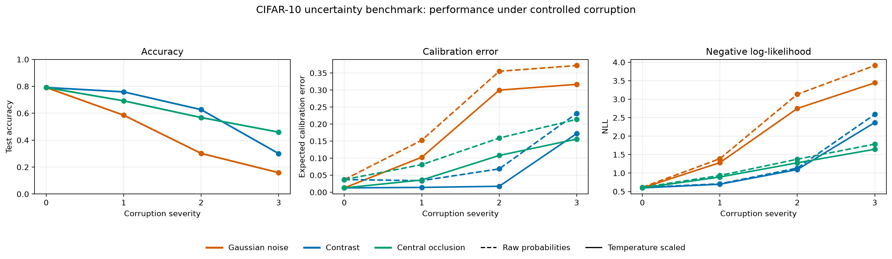
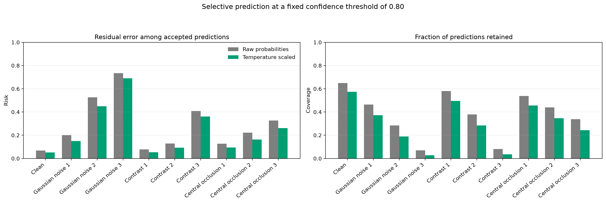
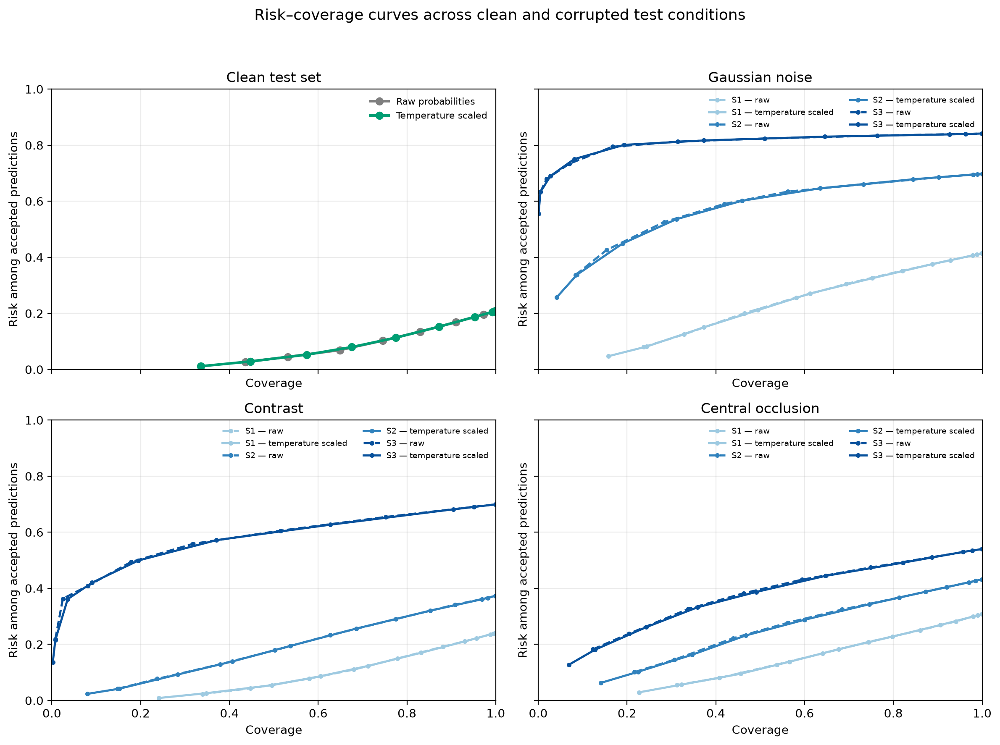

# Vision Uncertainty Bench: When Vision Gets It Wrong

A reproducible benchmark asking a simple question:

> **Does an image classifier know when its visual evidence has become unreliable?**

This repository evaluates a compact CIFAR-10 image classifier under controlled image corruptions. It separates three related but distinct questions:

1. Does predictive accuracy degrade under corrupted visual input?
2. Does confidence remain calibrated when the input distribution shifts?
3. Can confidence-threshold abstention reduce error among the predictions a system chooses to retain?

The project is deliberately modest in model scale and ambitious in evaluation discipline: clean validation data are reserved for calibration, the test set is untouched until final evaluation, every corruption is deterministic, and all reported figures can be regenerated from tracked CSV outputs.



## Headline finding

For this baseline model, **temperature scaling improves the interpretation of confidence under moderate corruption, but it does not make severely corrupted visual evidence reliable.**

At a fixed confidence threshold of 0.80:

- On clean CIFAR-10, temperature scaling reduces accepted-prediction risk from **6.9% to 5.3%**, while coverage falls from **64.9% to 57.4%**.
- Under severe Gaussian noise, temperature scaling accepts only **2.7%** of images — and risk among those accepted predictions remains **69.0%**.

Calibration can make a model more honest about uncertainty. It cannot restore information that is no longer present in the image.



## Research question and hypothesis

**Research question**

> How do controlled visual corruptions affect classification accuracy, calibration, and confidence-based abstention in a CIFAR-10 image classifier?

**Hypothesis**

As visual evidence degrades, accuracy and calibration will worsen. Temperature scaling, fitted only on held-out clean validation data, should improve confidence calibration under clean and moderately shifted inputs, but should not provide robust safety under severe corruption.

## Benchmark design

| Component | Design choice |
|---|---|
| Dataset | CIFAR-10 |
| Model | Compact CNN trained on clean images only |
| Train / validation split | 45,000 / 5,000 stratified images |
| Test set | Original untouched CIFAR-10 test set, 10,000 images |
| Split seed | `2026` |
| Model-selection criterion | Lowest clean validation cross-entropy |
| Calibration method | Temperature scaling fitted on clean validation logits |
| Calibration temperature | `T = 1.216870` |
| Selective prediction | Retain predictions only when maximum confidence meets a fixed threshold |
| Reported threshold | `0.80` |
| ECE bins | 15 equally sized confidence bins |

The final checkpoint was selected at epoch 14 of a 20-epoch baseline run using validation cross-entropy only. The test set was used only for the final reported evaluation.

## Controlled corruptions

The benchmark uses three deterministic corruption families at three severity levels each.

| Corruption | Severity 1 | Severity 2 | Severity 3 |
|---|---:|---:|---:|
| Gaussian noise | $\sigma = 0.04$ | $\sigma = 0.08$ | $\sigma = 0.16$ |
| Contrast reduction | factor 0.75 | factor 0.50 | factor 0.25 |
| Central black occlusion | 6 × 6 pixels | 10 × 10 pixels | 14 × 14 pixels |

These are controlled stress tests, not claims about real-world safety, adversarial robustness, or clinical deployment.

## Results

### Classification and calibration

Temperature scaling does not change predicted classes, so accuracy is identical for raw and calibrated probabilities. It changes the confidence assigned to those predictions.

| Condition | Accuracy | Raw ECE | Calibrated ECE | Raw NLL | Calibrated NLL |
|---|---:|---:|---:|---:|---:|
| Clean | 0.7912 | 0.0371 | 0.0127 | 0.6127 | 0.5986 |
| Gaussian noise, severity 1 | 0.5853 | 0.1526 | 0.1027 | 1.3886 | 1.2818 |
| Gaussian noise, severity 2 | 0.3017 | 0.3551 | 0.2999 | 3.1331 | 2.7496 |
| Gaussian noise, severity 3 | 0.1586 | 0.3721 | 0.3168 | 3.9124 | 3.4440 |
| Contrast, severity 3 | 0.3006 | 0.2316 | 0.1722 | 2.5901 | 2.3680 |
| Central occlusion, severity 3 | 0.4598 | 0.2141 | 0.1560 | 1.7845 | 1.6443 |

Gaussian noise is the most destructive condition in this controlled suite. Central occlusion causes a more gradual accuracy decline, while contrast reduction is relatively benign at low severity and damaging at high severity.

### Selective prediction

A prediction is accepted when:

$$
\max_k p(y=k \mid x) \geq 0.80
$$

Risk is the error rate among accepted predictions; coverage is the fraction of all predictions accepted.

| Condition | Raw risk | Calibrated risk | Raw coverage | Calibrated coverage |
|---|---:|---:|---:|---:|
| Clean | 0.0690 | 0.0526 | 0.6489 | 0.5739 |
| Gaussian noise, severity 1 | 0.2009 | 0.1501 | 0.4650 | 0.3730 |
| Gaussian noise, severity 2 | 0.5259 | 0.4489 | 0.2839 | 0.1900 |
| Gaussian noise, severity 3 | 0.7340 | 0.6898 | 0.0703 | 0.0274 |
| Contrast, severity 3 | 0.4084 | 0.3613 | 0.0808 | 0.0357 |
| Central occlusion, severity 3 | 0.3262 | 0.2614 | 0.3381 | 0.2433 |

The full risk–coverage curves show an important distinction: temperature scaling changes the numerical meaning of a fixed confidence threshold, but largely preserves the ranking of examples by confidence.



## Interpretation

Temperature scaling applies a single learned positive temperature to logits:

$$
p_T(y \mid x) = \operatorname{softmax}(z / T)
$$

Here, $T > 1$ softens overconfident predictions. It improves negative log-likelihood and expected calibration error, especially on clean data and moderate corruption.

However, temperature scaling is not a robustness intervention:

- it does not change model weights;
- it does not change the predicted class;
- it cannot recover evidence destroyed by noise, contrast loss, or occlusion;
- it does not make a fixed confidence threshold universally safe under severe distribution shift.

## Repository structure

```text
vision-uncertainty-bench/
├── configs/                 # Reproducible experiment settings
├── docs/                    # Methodology, limitations, and decisions
├── results/                 # Tracked final CSV outputs and figures
├── scripts/                 # Training, calibration, evaluation, plotting
├── src/vision_uncertainty_bench/
│   ├── calibration.py
│   ├── corruption_dataset.py
│   ├── corruptions.py
│   ├── data.py
│   ├── evaluation.py
│   ├── inference.py
│   ├── metrics.py
│   ├── models.py
│   ├── selective.py
│   ├── splits.py
│   └── training.py
└── tests/                   # Unit tests for core research logic
```

## Reproduce the committed figures

Create and activate a virtual environment:

```bash
python -m venv .venv
source .venv/bin/activate
python -m pip install --upgrade pip
python -m pip install -e ".[dev]"
```

Run the quality checks:

```bash
python -m ruff check .
python -m pytest
```

Regenerate the figures from the tracked final CSV outputs:

```bash
python scripts/plot_results.py
```

The resulting figures are written to:

```text
results/figures/
```

## Run the baseline training

Download CIFAR-10 locally:

```bash
python -c "from torchvision.datasets import CIFAR10; CIFAR10('data', train=True, download=True); CIFAR10('data', train=False, download=True)"
```

Train the clean-image baseline:

```bash
python scripts/train_baseline.py --config configs/baseline.json
```

The project scripts then support the full workflow:

```text
train clean baseline
    → select checkpoint using validation cross-entropy
    → fit temperature on validation logits only
    → evaluate once on clean and corrupted test conditions
    → generate tracked CSV outputs and figures
```

## Limitations

This repository is designed as a transparent controlled benchmark, not as evidence that a system is deployment-safe.

- Results currently come from one trained baseline seed; multi-seed reporting is a planned extension.
- CIFAR-10 is a small, curated benchmark and does not represent natural deployment shift.
- The corruptions are synthetic and intentionally narrow.
- Expected calibration error depends on binning and should not be interpreted alone.
- Confidence-based abstention is not equivalent to error detection, out-of-distribution detection, or uncertainty estimation.
- Temperature scaling is fit on clean validation data only; its behavior under severe shift should not be interpreted as a universal calibration guarantee.
- This project makes no claims about adversarial robustness, causal perception, real-world reliability, or safety-critical use.

See [methodology](docs/methodology.md) and [limitations](docs/limitations.md) for further detail.

## Next steps

- Repeat training across multiple random seeds and report uncertainty intervals.
- Add corruption-severity aggregate summaries across seeds.
- Compare temperature scaling with richer uncertainty methods.
- Add a carefully separated external-corruption evaluation such as CIFAR-10-C.
- Evaluate whether confidence ranking remains useful when corruption type is held out.

## License

This project is released under the MIT License. See [LICENSE](LICENSE).